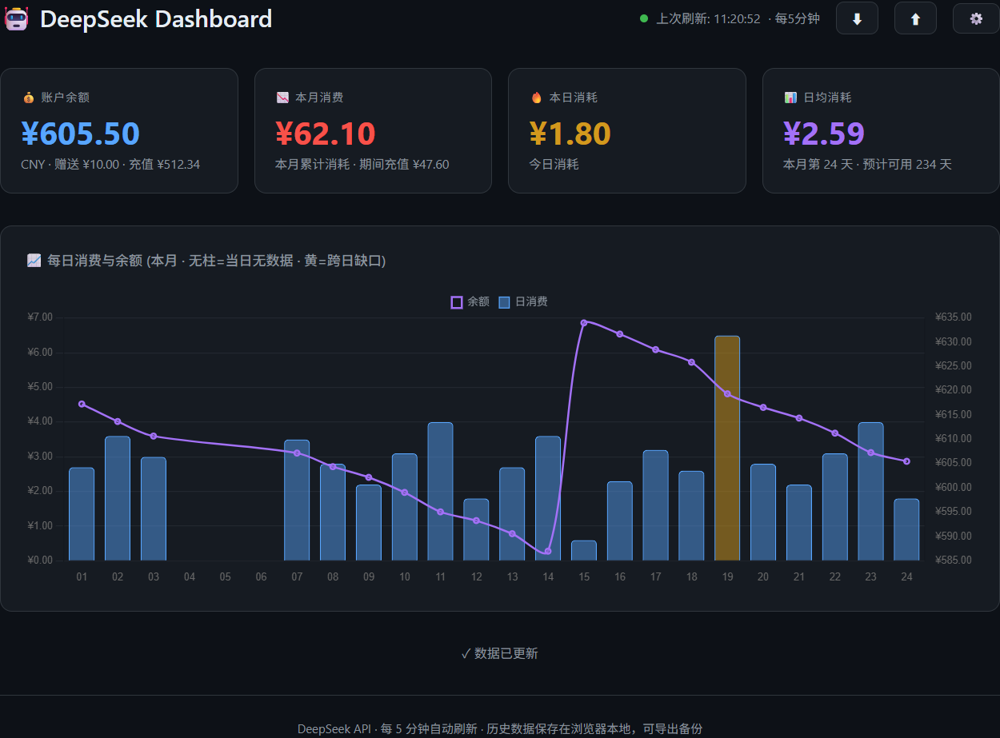

<div align="center">

# DeepSeek Balance Dashboard

**一个 HTML 文件就能用的 DeepSeek 余额与消费看板 · 零依赖 · 纯前端 · 数据不出本机**


</div>



> 截图使用示例数据，仅用于展示图表形态。

---

## ✨ 功能

| 模块 | 说明 |
|---|---|
| 💰 **账户余额** | 取官方 `total_balance`（赠送 + 充值），并把两者拆分显示 |
| 📉 **本月消费** | 按自然月累计；中途充值不会冲抵消费 |
| 🔥 **本日消费** | 跨日缺口单独标注，不把隔夜变动强行算进某一天 |
| 📊 **日均与预测** | 分母是「有数据的天数」而非日历天数，并给出「预计可用 N 天」 |
| 📈 **趋势图** | 日消费柱状 + 余额折线双 Y 轴，本月完整日历轴，无数据日留空 |
| 🔄 **自动刷新** | 每 5 分钟一次；切回前台且已超周期会自动补采 |
| 💾 **历史备份** | 一键导出 / 导入 JSON，可跨浏览器、跨设备迁移 |
| 🔒 **隐私** | API Key 只存在于本标签页内存与 `sessionStorage`，不上传、不落盘 |

## 🚀 快速开始

```bash
git clone https://github.com/Lizhenghe-Chen/deepseek-balance-dashboard.git
```

1. 双击打开 `index.html`（无需服务器、无需构建）
2. 在弹出的窗口里填入 API Key（`sk-` 开头，[在这里创建](https://platform.deepseek.com/api_keys)）
3. 保存即可看到余额与图表

> 也可以丢进任意静态站点托管，行为完全一致；用 `python -m http.server` 之类的本地服务器打开同样可以。

## 🔐 隐私与安全

| 问题 | 答案 |
|---|---|
| Key 会存到哪里？ | 仅内存 + 当前标签页的 `sessionStorage`，关闭标签页即清除，不写入磁盘 |
| Key 会被上传吗？ | 不会。页面只直连 `https://api.deepseek.com/user/balance` |
| 有第三方脚本吗？ | 只有 Chart.js（jsDelivr CDN，带 SRI 完整性校验）；可用 CSP 外联白名单限制到只允许 DeepSeek 域名 |
| 历史数据在哪？ | 浏览器 `localStorage` 的 `ds_history_v2` 键，只有余额快照，不含 Key |
| 会泄露给其他网页吗？ | 页面带 `Content-Security-Policy`，`connect-src` 仅放行 `api.deepseek.com`，即便被注入也无法把数据发去别处 |

历史里保存的是 Key 的 **djb2 指纹**（用于区分不同账号），不是 Key 本身。

## 📐 消费是怎么算出来的

官方文档明确：`total_balance = granted_balance + topped_up_balance`，且扣费时**优先扣赠送额度**。因此：

- ✅ 用 `total_balance` 跟踪余额。若只看 `topped_up_balance`，赠送额度没花完时消费会一直显示 **0**。
- ✅ 消费 = **相邻两次采样余额差值的累加**，而不是「当天首尾差」。后者一旦中途充值，当天消费会被抹成 0。
- ✅ 充值（余额上升）单独统计为「期间充值」，绝不冲抵消费。
- ⚠️ 只有**跨日且余额确实变化**的区间才标记为黄色缺口——这时无法确定这笔变动属于前一天还是当天。

**已知失真**

- 赠送额度过期也会让 `total_balance` 下降，会被记为当天消费。
- 页面未打开期间无法采样：总量仍会体现在下次采样里，但无法得知具体发生在哪一天（表现为黄色缺口或当天柱子偏高）。
- 余额精度为 2 位小数，因此小于 `¥0.01` 的消费不可见。

## 🧱 数据模型

```json
{
  "k": "892efcc3",
  "cur": "CNY",
  "lastPoll": 1792811247065,
  "s": [
    { "t": 1792809600000, "b": 561.77 },
    { "t": 1792811247065, "b": 560.52 }
  ]
}
```

| 字段 | 含义 |
|---|---|
| `k` | API Key 的 djb2 指纹，换账号时历史自动重置 |
| `cur` | 币种，仅跟踪一种（CNY 或 USD），避免多币种相加 |
| `lastPoll` | 上次轮询时间，用于判断是否需要补采 |
| `s` | 采样点数组：`t` 为毫秒时间戳，`b` 为余额；**仅在余额变化时追加** |

保留最近 90 天。旧版本的 `ds_history` 会在首次打开时自动迁移。

## ❓ FAQ

<details>
<summary><b>为什么一开始图表是空的，或者消费显示 0？</b></summary>

消费由两次采样的差值推导，至少需要两次「余额发生变化」的采样。刚设置好 Key 时只有一个点，稍等一轮刷新即可。
</details>

<details>
<summary><b>关掉浏览器还会继续记录吗？</b></summary>

不会。这是纯前端方案，没有后台进程；这是它保持「零部署」的代价。
</details>

<details>
<summary><b>换了 API Key，历史怎么没了？</b></summary>

刻意设计。不同账号的余额互相做差会产生巨额假消费，因此检测到 Key 指纹或币种变化时会自动清空历史。
</details>

<details>
<summary><b>提示「图表库未加载」？</b></summary>

说明 Chart.js 没能从 CDN 取到（离线或被网络策略拦截）。此时数据刷新、导出仍然可用；也可把 `chart.umd.js` 下载到同目录并改掉 `index.html` 里的 `<script src>`。
</details>

<details>
<summary><b>能改成 1 分钟刷新吗？</b></summary>

可以（改 `POLL_MS`），但收益很小：余额只有 2 位小数，短间隔的绝大多数采样是完全相同的值，只会更快地消耗存储配额。
</details>

## 🛠 项目结构

```
.
├── index.html        # 全部实现：HTML + CSS + JS（单文件）
├── docs/
│   └── screenshot.png
├── .gitignore
├── LICENSE
└── README.md
```

技术栈：原生 JS + [Chart.js 4](https://www.chartjs.org/)（CDN + SRI）。无构建、无依赖、无后端。

## 📄 许可

[MIT](LICENSE) © 2026 Lizhenghe-Chen
