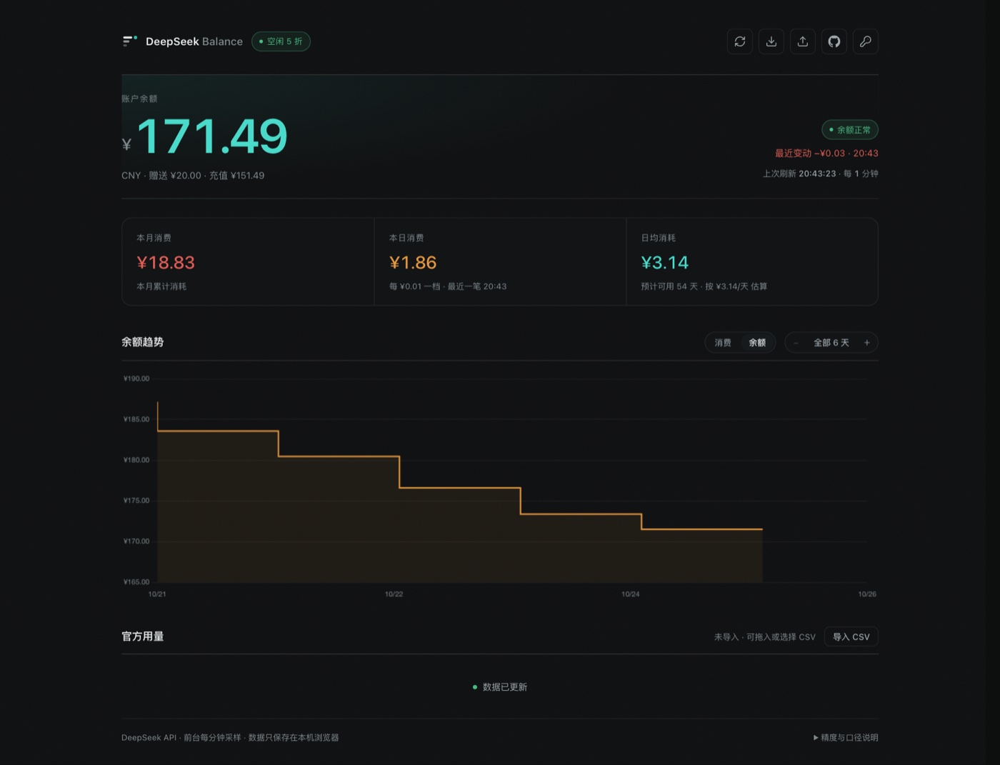

<div align="center">

# DeepSeek Balance Dashboard

**一个 HTML 文件就能用的 DeepSeek 余额与消费看板 · 零依赖 · 纯前端 · 数据不出本机**


[**🌐 在线打开**](https://bunnychen.top/deepseek-balance-dashboard/) · 无需克隆

</div>



> 截图使用示例数据，仅用于展示图表形态。

---

## ✨ 功能

| 模块 | 说明 |
|---|---|
| 💰 **账户余额** | 主卡：整行大字 + 状态徽章（正常 / 偏低 / 不足）+ 最近一次变动，并拆分赠送 / 充值；双币种时显示「另有 USD $x」 |
| 📉 **本月消费** | 按自然月累计；中途充值不冲抵消费 |
| 🔥 **本日消费** | 官方与观测只取**较大值**，避免导出快照让当天数字变小；副标题给出「每 ¥0.01 一档 · 最近一笔 HH:MM」 |
| 📊 **日均与预测** | 按「第一个有数据的那天到今天」的自然日计算；「预计可用 N 天」给出**区间**，样本不足 3 天时直说「样本不足」 |
| 📈 **趋势图** | 余额 / 累计消费两种视图，偏好会记住。阶梯线、跨度跟着数据走，`−` / `＋` 连续缩放（最小 2 小时）；缩放不丢台阶细节，只有一屏画不下时才聚合，并在标题下注明粒度；悬停按台阶判定：陡降 / 陡升的上下两个端点各选各的，水平段上则跟着指针显示「自 X 起未变动」 |
| 🕐 **峰谷时段** | 顶栏徽章实时显示「高峰 2× 单价 / 空闲 5 折」（北京时间工作日 09–12、14–18 为高峰） |
| 🧾 **官方用量** | 可选：导入控制台导出的 `amount-*.csv` / `cost-*.csv`，过去整天改用官方日成本，另得缓存命中率、分模型成本与对账差；每次导入单独成条，可删除、8 秒内可撤销 |
| 🔔 **低余额提醒** | 可选的桌面通知，跌破自定义阈值时提醒一次（仅页面打开时生效） |
| 🔄 **自动刷新** | 前台每分钟采样、后台 5 分钟，回到前台立即补采；`↻` 可手动刷新（请求带 `no-store`） |
| 🔁 **多账户** | 每个 Key 一份独立历史，换 Key 不清空、不互相做差；可重命名、可逐个删除，最多 5 个账户 / 每份 60 天 |
| 💾 **历史备份** | 一键导出全部账户 + 官方用量为 JSON，跨浏览器 / 设备迁移 |
| 🔒 **隐私** | 无后端、无统计；Key 默认只在内存与 `sessionStorage`，只发给 `api.deepseek.com` |

## 🚀 快速开始

**方式一：直接访问在线版**（推荐）

<https://bunnychen.top/deepseek-balance-dashboard/>

**方式二：克隆到本地**

```bash
git clone https://github.com/Lizhenghe-Chen/deepseek-balance-dashboard.git
```

1. 双击打开 `index.html`（无需服务器、无需构建）
2. 在弹出的窗口里填入 API Key（`sk-` 开头，[在这里创建](https://platform.deepseek.com/api_keys)）
3. 保存即可看到余额与图表

> 用 `python -m http.server` 之类的本地服务器打开同样可以。

两种方式功能完全一致。数据全部保存在**你自己的浏览器**里：在线版与本地版属于不同来源（origin），历史互不相通，跨设备 / 跨浏览器请用导出 / 导入 JSON 迁移。

## 🔐 隐私

- **没有后端、没有统计**：页面只跟 `https://api.deepseek.com` 通信，数据全部留在你自己的浏览器。
- **Key 默认不落盘**：只存在内存与当前标签页的 `sessionStorage`；想省事可在设置里勾选「记住 Key」，由你自己决定是否写进 `localStorage`。
- **公开托管 = 公开代码，不是公开数据**：任何人打开网址看到的都是同一份前端，各自拥有自己的本地历史。

边界与细节（同源风险、CSP 能挡什么、CSV 会不会上传）见 [隐私与安全](docs/security.md)。

## 📚 文档

| 文档 | 内容 |
|---|---|
| [使用与账户](docs/usage.md) | 多账户 / 换 Key、历史备份与迁移、官方用量 CSV、低余额提醒 |
| [测量精度与消费口径](docs/accuracy.md) | 2 位小数带来的误差、消费怎么算、已知失真 |
| [数据模型](docs/data-model.md) | `localStorage` 结构、采样与保留策略 |
| [部署到 GitHub Pages](docs/deploy.md) | Pages 配置、自定义域名、公开托管注意事项 |
| [隐私与安全](docs/security.md) | Key 存在哪、CSP 边界、同源风险 |
| [FAQ](docs/faq.md) | 图表为空、CNY / USD、CSV 细节、采样频率、429 退避…… |

## ❓ 常见问题

<details>
<summary><b>为什么一开始图表是空的，或者消费显示 0？</b></summary>

消费由两次采样的差值推导，至少需要两次「余额发生变化」的采样。刚设置好 Key 时只有一个点，稍等一轮刷新即可。
</details>

<details>
<summary><b>关掉浏览器还会继续记录吗？</b></summary>

不会。纯前端方案没有后台进程——这也是它保持「零部署」的代价。
</details>

<details>
<summary><b>数据存在哪？怎么换电脑？</b></summary>

全部在浏览器 `localStorage`（键名 `ds_history_v3`），按来源（origin）隔离。换设备 / 换浏览器请用顶栏「导出历史数据」写出一份 JSON，再到新环境「导入历史数据」合并；字段结构见 [数据模型](docs/data-model.md)。

换 Key、CNY / USD、CSV 规则、图表跨度、采样频率等更多问题见 [FAQ](docs/faq.md)。
</details>

## 🛠 项目结构

```
.
├── index.html            # 全部实现：HTML + CSS + JS（单文件）
├── docs/
│   ├── screenshot.jpg    # 界面预览图
│   ├── usage.md          # 使用与账户
│   ├── accuracy.md       # 测量精度与消费口径
│   ├── data-model.md     # 数据模型
│   ├── deploy.md         # 部署到 GitHub Pages
│   ├── security.md       # 隐私与安全
│   └── faq.md            # FAQ
├── .nojekyll             # 让 GitHub Pages 原样发布，跳过 Jekyll
├── .gitignore
├── LICENSE
└── README.md
```

技术栈：原生 JS + [Chart.js 4](https://www.chartjs.org/)（CDN + SRI）。无构建、无依赖、无后端。

## 📄 许可

[MIT](LICENSE) © 2026 Lizhenghe-Chen
